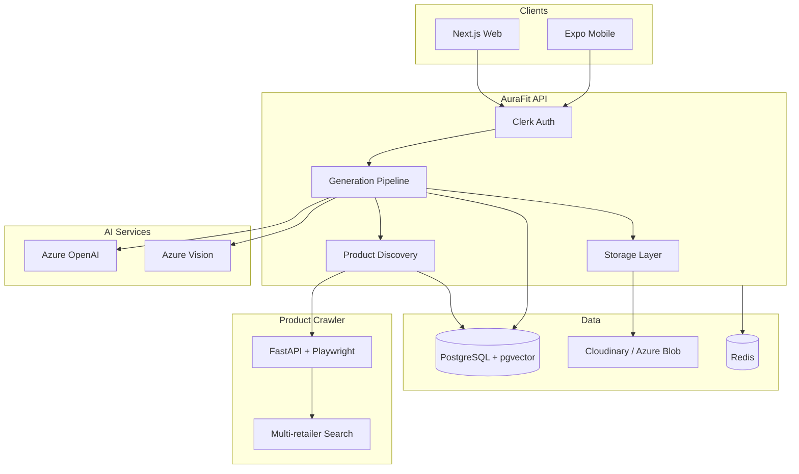
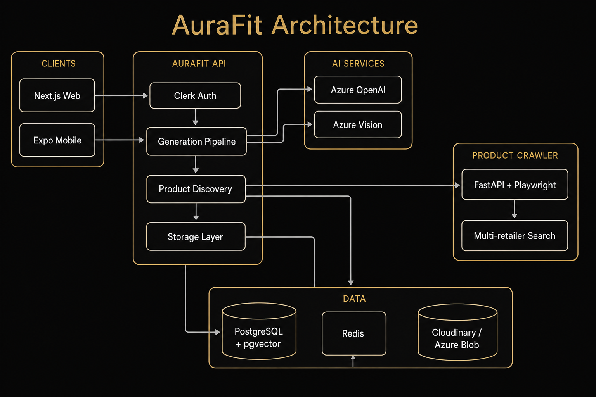

# AuraFit

**AI-native fashion styling** — upload your photo, define your vibe, get six editorial looks with shoppable product links.

[](https://github.com/kenzzhood/AuraFit/actions/workflows/ci.yml)
[](LICENSE)

---

## Overview

AuraFit is a full-stack AI fashion platform:

- **Web** — Next.js studio for style preferences, look generation, wardrobe, and social explore
- **Mobile** — Expo (React Native) app with local-first photos and native UX
- **Product discovery** — Self-hosted Playwright crawler (no SerpAPI required)
- **AI pipeline** — Azure OpenAI for chat, vision, embeddings, and multi-image fashion boards

Built for hackathons, portfolios, and production deployment on **Azure Container Apps** or **Vercel + Supabase**.

---

## Screenshots

> Add captures to [`docs/screenshots/`](docs/screenshots/) before submission.

| Generate | Looks | Mobile |
|----------|-------|--------|
| *Coming soon* | *Coming soon* | *Coming soon* |

---

## Demo

| Asset | Link |
|-------|------|
| **Live demo** | Start with `npm run azure:start` — URL in [docs/deploy/azure-runbook.md](docs/deploy/azure-runbook.md) |
| **Demo video** | *Add YouTube/Loom URL* |
| **Android APK** | Build with [docs/MOBILE_BUILD.md](docs/MOBILE_BUILD.md) — *add Expo artifact or Release URL* |
| **Pitch deck** | *Add link or commit to `docs/`* |

---

## Architecture





Extended design: [docs/architecture-v2.md](docs/architecture-v2.md) · [docs/product-discovery.md](docs/product-discovery.md)

---

## Tech stack

| Layer | Technology |
|-------|------------|
| Frontend | Next.js 15, React 19, Tailwind CSS, Framer Motion |
| Mobile | Expo 52, React Native, NativeWind |
| Backend | Next.js App Router API routes, Prisma ORM |
| Database | PostgreSQL 16 + pgvector |
| Auth | Clerk |
| AI | Azure OpenAI (GPT-4o, embeddings, DALL-E / gpt-image) |
| Crawler | FastAPI, Playwright, Crawl4AI |
| Queue | Inngest (or inline for dev) |
| Storage | Cloudinary or Azure Blob |
| Infra | Azure Container Apps, Bicep, azd |
| CI | GitHub Actions |

---

## Quick start

### Backend (local)

```bash
git clone https://github.com/kenzzhood/AuraFit.git
cd AuraFit
npm install

cp .env.example .env.local
cp apps/mobile/.env.example apps/mobile/.env
# Add YOUR keys — docs/SETUP_YOUR_KEYS.md

docker compose -f docker-compose.postgres.yml up -d   # optional local DB
npm run db:push
npm run dev
```

Open [http://localhost:3000/generate](http://localhost:3000/generate)

### Product crawler (local)

```bash
export CRAWLER_API_KEY=$(openssl rand -hex 32)
echo "CRAWLER_API_KEY=$CRAWLER_API_KEY" >> .env.local
docker compose -f docker-compose.crawler.yml up --build
```

### Mobile

```bash
cp apps/mobile/.env.example apps/mobile/.env
# Set EXPO_PUBLIC_API_URL to your LAN IP + Clerk publishable key

npm run dev          # API :3000
npm run dev:mobile   # Expo
```

Full guide: [docs/mobile-setup.md](docs/mobile-setup.md)

---

## Environment variables

**No keys ship with this repo.** Each developer uses their own accounts:

```bash
cp .env.example .env.local
cp apps/mobile/.env.example apps/mobile/.env
```

**→ [docs/SETUP_YOUR_KEYS.md](docs/SETUP_YOUR_KEYS.md)** — Clerk, Postgres, Azure OpenAI, storage, crawler, mobile.

| Variable | Required | Purpose |
|----------|----------|---------|
| `DATABASE_URL` | Yes | PostgreSQL connection |
| `NEXT_PUBLIC_CLERK_PUBLISHABLE_KEY` | Yes | Auth (your Clerk app) |
| `CLERK_SECRET_KEY` | Yes | Auth (your Clerk app) |
| `AZURE_OPENAI_*` | Yes* | Chat, looks, embeddings, images |
| `STORAGE_PROVIDER` + keys | Yes | Photo uploads |
| `PRODUCT_CRAWLER_URL` | Recommended | Real product links |
| `CRAWLER_API_KEY` | With crawler | Crawler authentication |
| `INNGEST_*` | Production | Background jobs |
| `REDIS_URL` | Production | Distributed rate limits |

### Catalogue search flags

These are read at runtime from the environment. Unset values keep today's search path. Set a flag to `false` to turn that behaviour off without deleting the code.

| Variable | Start default | Purpose |
|----------|---------------|---------|
| `GOOGLE_SHOPPING_ENABLED` | `true` | Crawler Google Shopping (`udm=28`) path |
| `SERPAPI_ENABLED` | `true` | SerpAPI path, still requires `SERPAPI_KEY` |
| `LIVE_PLAYWRIGHT_IN_REQUEST` | `true` | In-request Playwright recovery crawl |
| `VERIFIER_V2` | `false` | New link verifier |
| `CLICK_REVALIDATE` | `false` | Re-check a link at click time |
| `HYBRID_SEARCH` | `false` | Postgres full-text plus vector search |
| `DISCOVERY_V2` | `false` | Index-only discovery, scoring, and diversity |
| `SLOT_QUERY_MODE` | `v1` | `v2` fans out several queries per slot |
| `REQUIRE_GENDER` | `false` | Do not assume men when gender is missing |
| `CACHE_BACKEND` | `memory` | `postgres` uses the shared discovery cache table |
| `DELIVERY_TIERS` | `false` | India delivery labels |
| `GENERATION_SHORTLIST` | `false` | Verify a shortlist before painting a board |
| `INGEST_FLIPKART_ENABLED` | `false` | Flipkart feed job |
| `INGEST_ADMITAD_ENABLED` | `false` | Admitad feed job |
| `INGEST_AMAZON_ENABLED` | `false` | Amazon Creators API job |
| `INGEST_SHOPIFY_ENABLED` | `false` | Shopify `/products.json` job |
| `INGEST_SITEMAP_ENABLED` | `false` | Sitemap JSON-LD job |

\* Without Azure OpenAI, generation degrades to demo products and heuristics.

See [`.env.example`](.env.example) for all variables.

---

## Deployment

| Path | Guide |
|------|-------|
| Azure (production + pause/resume) | [docs/deploy/azure-runbook.md](docs/deploy/azure-runbook.md) |
| Vercel + Supabase (hackathon MVP) | [docs/hackathon/setup.md](docs/hackathon/setup.md) |
| Step-by-step checklist | [docs/deploy/checklist.md](docs/deploy/checklist.md) |

```bash
# Azure one-liner flow
npm run azure:setup && npm run azure:up && npm run azure:db-init
npm run azure:stop   # pause billing when done
```

---

## Development

```bash
npm run type-check
npm test                              # SSRF + security unit tests
npm run build
cd services/product-crawler && python3 -m pytest tests/
```

---

## Security

- Report vulnerabilities privately — see [SECURITY.md](SECURITY.md)
- **No API keys in this repo** — [docs/SETUP_YOUR_KEYS.md](docs/SETUP_YOUR_KEYS.md)
- Before public release: [docs/security/git-history-purge.md](docs/security/git-history-purge.md) if secrets were ever committed
- Latest audit: [docs/security/audit.md](docs/security/audit.md)

---

## Contributing

We welcome contributions. See [CONTRIBUTING.md](CONTRIBUTING.md).

---

## Documentation index

| Document | Description |
|----------|-------------|
| [docs/README.md](docs/README.md) | **Full documentation index** |
| [docs/SETUP_YOUR_KEYS.md](docs/SETUP_YOUR_KEYS.md) | **Bring your own API keys** |
| [docs/deploy/checklist.md](docs/deploy/checklist.md) | Zero-to-production deploy |
| [docs/deploy/azure-runbook.md](docs/deploy/azure-runbook.md) | Azure ops runbook |
| [docs/hackathon/setup.md](docs/hackathon/setup.md) | Vercel + Supabase stack |
| [docs/hackathon/submission-checklist.md](docs/hackathon/submission-checklist.md) | Submission pass/fail |
| [docs/security/release-readiness.md](docs/security/release-readiness.md) | Public release gate |
| [docs/architecture-v2.md](docs/architecture-v2.md) | System design |
| [docs/MOBILE_BUILD.md](docs/MOBILE_BUILD.md) | EAS / APK builds |
| [docs/mobile-setup.md](docs/mobile-setup.md) | Mobile dev setup |

---

## License

[MIT](LICENSE) © AuraFit contributors
