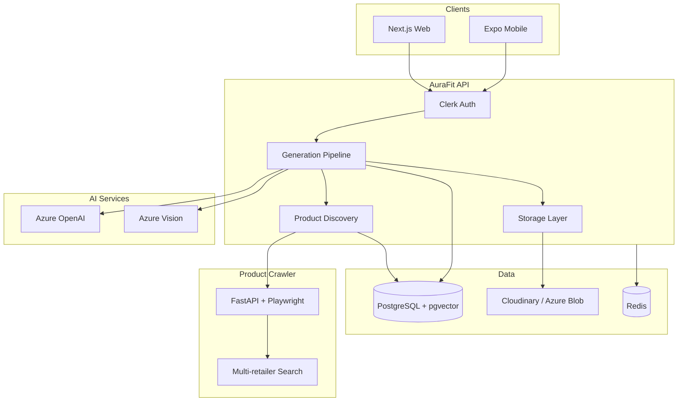
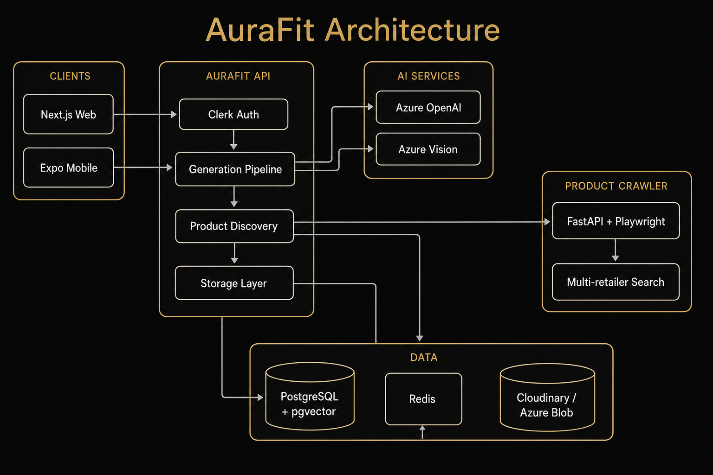

# AuraFit

**AI-native fashion styling** — upload your photo, define your vibe, get six editorial looks with shoppable product links.

[](https://github.com/kenzzhood/AuraFit/actions/workflows/ci.yml)
[](LICENSE)

---

## Overview

AuraFit is a full-stack AI fashion platform:

- **Web** — Next.js studio for style preferences, look generation, wardrobe, and social explore
- **Mobile** — Expo (React Native) app with local-first photos and native UX
- **Product discovery** — Self-hosted Playwright crawler (no SerpAPI required)
- **AI pipeline** — Azure OpenAI for chat, vision, embeddings, and multi-image fashion boards

Built for hackathons, portfolios, and production deployment on **Azure Container Apps** or **Vercel + Supabase**.

The IGDC stall build is a separate kiosk at `/stall`. Its on-screen name is **Autofit** (`APP_DISPLAY_NAME` in `src/stall/brand.ts`). Change that one line to show AuraFit again.

---

## Windows quick start

The demo laptop is Windows with Chrome. Postgres, Clerk, Redis, and Docker are not required.

1. Install **Node.js LTS** from [https://nodejs.org/](https://nodejs.org/) if it is not already installed. Use the Windows installer from that page. Close and reopen File Explorer after installing so `node` and `npm` are on your PATH.
2. Get this branch onto the laptop:
   - Download the ZIP: [AuraFit stall branch](https://github.com/kenzzhood/AuraFit/archive/refs/heads/cursor/autofit-igdc-stall-0b54.zip). Unzip it. The folder name will look like `AuraFit-cursor-autofit-igdc-stall-0b54`.
   - Or, in Command Prompt: `git clone https://github.com/kenzzhood/AuraFit.git` then `cd AuraFit` and `git checkout cursor/autofit-igdc-stall-0b54`.
3. Double-click **`start-autofit.bat`** in that folder. The first run downloads dependencies and needs the internet. When the stall is ready, Chrome opens at [http://localhost:3000/stall](http://localhost:3000/stall) in kiosk (fullscreen) mode. If Chrome is not installed, the default browser opens instead. Leave the black command window open. Close that window to stop the stall.
4. When Chrome asks for the camera, click **Allow**. Localhost is a secure context, so the webcam works without HTTPS. Pinch a card, or click it. Mouse and touch work if hand tracking drops.
5. Live Azure generation is optional. Demo previews work with no key.
   - In File Explorer, open the **View** menu and turn on **File name extensions**.
   - Copy `.env.example`, paste it in the same folder, and rename the copy to `.env` (the name is `.env` only, not `.env.txt`).
   - Right-click `.env`, choose **Open with**, then **Notepad**.
   - Fill in `AZURE_FOUNDRY_ENDPOINT`, `AZURE_FOUNDRY_API_KEY`, `AZURE_FOUNDRY_IMAGE_DEPLOYMENT`, and `AZURE_FOUNDRY_API_VERSION`. Save.
   - Close the command window and double-click `start-autofit.bat` again. The header pill switches to **Live · Azure AI Foundry**.

After that first install, catalog, characters, hand tracking, and demo previews work with the internet off. Only live image generation calls Azure. Placeholder Postgres and Clerk lines in `.env` are ignored by the stall.

## Running at the stall

On a Mac, or from a terminal on Windows:

```bash
npm install
npm run stall
```

Open [http://localhost:3000/stall](http://localhost:3000/stall). With `npm run stall`, `/` redirects there. Then:

1. Allow the camera when Chrome asks. Localhost is a secure context, so the webcam works without HTTPS.
2. Press **Full screen** (or F11). The layout is landscape for a TV or monitor.
3. Pinch a card, or click it. Pinch and drag a picture into the cart on the left. An open palm, or **Take photo**, starts a 3-2-1 countdown.
4. The catalog and character portraits are local. The kiosk does not scrape stores during the demo.
5. If hand tracking fails, mouse and touch still drag, scroll and press. Escape returns to the start screen.
6. The result screen returns to the start screen after about 90 seconds.

`npm run stall` copies the MediaPipe wasm into `public/mediapipe/wasm` and starts Next.js in dev mode so Clerk and Postgres are not required.

## Adding your Azure key

Live try-on is off until a key is present. Demo previews are the default.

1. In [Azure AI Foundry](https://ai.azure.com), create a project and deploy **gpt-image-1** (or a newer Foundry image model that supports image edits, such as gpt-image-1.5). Name the deployment, for example `gpt-image-1`.
2. Copy the endpoint (host only is enough, for example `https://YOUR-RESOURCE.cognitiveservices.azure.com` or `https://YOUR-RESOURCE.openai.azure.com`) and a key.
3. From the repo root: `cp .env.example .env`. On Windows, use the Notepad steps in **Windows quick start**.
4. Set:
   - `AZURE_FOUNDRY_ENDPOINT`
   - `AZURE_FOUNDRY_API_KEY`
   - `AZURE_FOUNDRY_IMAGE_DEPLOYMENT` (the deployment name, not the model family if you renamed it)
   - `AZURE_FOUNDRY_API_VERSION` (default `2025-04-01-preview`)
5. Restart `npm run stall`. The header pill switches from **Demo preview** to **Live · Azure AI Foundry**. No code change and no key in the browser.
6. Set `AUTOFIT_FORCE_DEMO=true` to rehearse the fallback even when a key is present.

The stall does not call the public OpenAI API. `AZURE_OPENAI_ENDPOINT`, `AZURE_OPENAI_API_KEY` and `AZURE_OPENAI_DEPLOYMENT_IMAGE` are accepted as aliases if the Foundry variables are empty.

## Try-on prompts

Both prompts live in `src/stall/prompts.ts`.

- **Make your own style:** a full-body photoreal edit. It keeps the visitor's face, skin tone and body shape, and applies each cart item's colour, pattern and cut from the reference images.
- **Try your favorite character:** the same identity lock, then one character's hairstyle, outfit and signature accessories in a single transfer. The character portrait is only a colour and shape guide.

Find my look (budget, occasion, six outfits) is not in this build.

## Stall catalog

Products are real Myntra and Amazon.in listings. Photos sit next to the JSON in one folder per category, so the kiosk stays offline. The stall reads these folders when a request comes in (`src/stall/folder-catalog.ts`). There is no single `catalog.json`.

```
public/catalog/tops/
public/catalog/bottoms/
public/catalog/coats/
public/catalog/dresses/
public/catalog/accessories/watches/
public/catalog/accessories/necklaces/
public/catalog/accessories/shoes/
public/catalog/accessories/hats/
```

Each folder has `items.json`, the product photos, and `_template.json`. The category and accessory type come from the folder, not from the JSON.

The committed set is a short, hand-picked catalog so the gesture UI can browse it without a long scroll. About 40 pieces in each clothing folder and about 12 in each accessory folder. Photos are sharp Myntra studio shots on clean backgrounds, with men and women and the style chips spread through the grid.

| Category | Items |
| --- | ---: |
| Tops | 40 |
| Bottoms | 40 |
| Dresses (including sarees) | 40 |
| Jackets and coats (including sherwanis) | 40 |
| Watches | 12 |
| Necklaces | 12 |
| Shoes | 12 |
| Hats | 12 |
| **Total** | **208** |

Every item has one style. Across the catalog: casual 35, festive 26, formal 21, vintage 21, smart casual 15, old money 14, minimalist 13, sporty 13, streetwear 13, party 12, boho 8, aesthetic 6, y2k 6, korean 5. Tops are split evenly between men and women. Dresses are women’s wear, including grand ethnic pieces. Sherwanis are in coats. Drop another photo and a JSON entry in the same folder to grow a category; the stall picks up new files on the next request.

### Add a product

1. Put the photo in the category folder. Example: `public/catalog/tops/my-shirt.jpg`.
2. Copy `_template.json` to `my-shirt.json` in that same folder, or add an object to the `items` array in `items.json`.
3. Restart the stall (`start-autofit.bat` or `npm run stall`).

`_template.json` is ignored. A file whose `id` is `example-id` is ignored. The photo file name must match `image`, and it must sit in the same folder (no subfolders, no `..`).

```json
{
  "id": "my-shirt",
  "title": "Product title",
  "brand": "Brand",
  "priceInr": 1999,
  "mrpInr": 3999,
  "url": "https://www.myntra.com/product/example/buy",
  "image": "my-shirt.jpg",
  "store": "myntra",
  "gender": "women",
  "style": "casual",
  "color": "Black"
}
```

`store` is `myntra` or `amazon`. `gender` is `women`, `men`, or `unisex`. `style` is one of: `old-money`, `aesthetic`, `casual`, `formal`, `festive`, `streetwear`, `y2k`, `minimalist`, `boho`, `party`, `sporty`, `korean`, `vintage`, `smart-casual`.

You can also keep many products in one `items.json`:

```json
{ "items": [ { "id": "my-shirt" } ] }
```

## Characters

100 anime characters are in `public/characters/anime/` and 50 game characters are in `public/characters/games/`. The Try your favorite character screen has an Anime / Games toggle. Each entry is a local reference image plus a written outfit and hair description. Azure `images.edit` sends that image as reference image 2. The prompt copies the hair and the clothes from it and keeps the visitor’s face.

The portraits are reference art for this kiosk. The names and artwork belong to their rights holders.

### Add a character

Use the same drop-in shape. Copy `_template.json` in `public/characters/anime/` or `public/characters/games/`.

```json
{
  "id": "naruto",
  "name": "Naruto Uzumaki",
  "series": "Naruto",
  "image": "naruto.png",
  "look": "spiky blond hair, orange and black jacket, orange trousers, headband",
  "hair": "spiky blond hair"
}
```

Put `naruto.png` in that same folder, then restart the stall.

---

## Screenshots

> Add captures to [`docs/screenshots/`](docs/screenshots/) before submission.

| Generate | Looks | Mobile |
|----------|-------|--------|
| *Coming soon* | *Coming soon* | *Coming soon* |

---

## Demo

| Asset | Link |
|-------|------|
| **Live demo** | Start with `npm run azure:start` — URL in [docs/deploy/azure-runbook.md](docs/deploy/azure-runbook.md) |
| **Demo video** | *Add YouTube/Loom URL* |
| **Android APK** | Build with [docs/MOBILE_BUILD.md](docs/MOBILE_BUILD.md) — *add Expo artifact or Release URL* |
| **Pitch deck** | *Add link or commit to `docs/`* |

---

## Architecture





Extended design: [docs/architecture-v2.md](docs/architecture-v2.md) · [docs/product-discovery.md](docs/product-discovery.md)

---

## Tech stack

| Layer | Technology |
|-------|------------|
| Frontend | Next.js 15, React 19, Tailwind CSS, Framer Motion |
| Mobile | Expo 52, React Native, NativeWind |
| Backend | Next.js App Router API routes, Prisma ORM |
| Database | PostgreSQL 16 + pgvector |
| Auth | Clerk |
| AI | Azure OpenAI (GPT-4o, embeddings, DALL-E / gpt-image) |
| Crawler | FastAPI, Playwright, Crawl4AI |
| Queue | Inngest (or inline for dev) |
| Storage | Cloudinary or Azure Blob |
| Infra | Azure Container Apps, Bicep, azd |
| CI | GitHub Actions |

---

## Quick start

### Backend (local)

```bash
git clone https://github.com/kenzzhood/AuraFit.git
cd AuraFit
npm install

cp .env.example .env.local
cp apps/mobile/.env.example apps/mobile/.env
# Add YOUR keys — docs/SETUP_YOUR_KEYS.md

docker compose -f docker-compose.postgres.yml up -d   # optional local DB
npm run db:push
npm run dev
```

Open [http://localhost:3000/generate](http://localhost:3000/generate)

### Product crawler (local)

```bash
export CRAWLER_API_KEY=$(openssl rand -hex 32)
echo "CRAWLER_API_KEY=$CRAWLER_API_KEY" >> .env.local
docker compose -f docker-compose.crawler.yml up --build
```

### Mobile

```bash
cp apps/mobile/.env.example apps/mobile/.env
# Set EXPO_PUBLIC_API_URL to your LAN IP + Clerk publishable key

npm run dev          # API :3000
npm run dev:mobile   # Expo
```

Full guide: [docs/mobile-setup.md](docs/mobile-setup.md)

---

## Environment variables

**No keys ship with this repo.** Each developer uses their own accounts:

```bash
cp .env.example .env.local
cp apps/mobile/.env.example apps/mobile/.env
```

**→ [docs/SETUP_YOUR_KEYS.md](docs/SETUP_YOUR_KEYS.md)** — Clerk, Postgres, Azure OpenAI, storage, crawler, mobile.

| Variable | Required | Purpose |
|----------|----------|---------|
| `DATABASE_URL` | Yes | PostgreSQL connection |
| `NEXT_PUBLIC_CLERK_PUBLISHABLE_KEY` | Yes | Auth (your Clerk app) |
| `CLERK_SECRET_KEY` | Yes | Auth (your Clerk app) |
| `AZURE_OPENAI_*` | Yes* | Chat, looks, embeddings, images |
| `STORAGE_PROVIDER` + keys | Yes | Photo uploads |
| `PRODUCT_CRAWLER_URL` | Recommended | Real product links |
| `CRAWLER_API_KEY` | With crawler | Crawler authentication |
| `INNGEST_*` | Production | Background jobs |
| `REDIS_URL` | Production | Distributed rate limits |

### Catalogue search flags

These are read at runtime from the environment. Unset values keep today's search path. Set a flag to `false` to turn that behaviour off without deleting the code.

| Variable | Start default | Purpose |
|----------|---------------|---------|
| `GOOGLE_SHOPPING_ENABLED` | `true` | Crawler Google Shopping (`udm=28`) path |
| `SERPAPI_ENABLED` | `true` | SerpAPI path, still requires `SERPAPI_KEY` |
| `LIVE_PLAYWRIGHT_IN_REQUEST` | `true` | In-request Playwright recovery crawl |
| `VERIFIER_V2` | `false` | New link verifier |
| `CLICK_REVALIDATE` | `false` | Re-check a link at click time |
| `HYBRID_SEARCH` | `false` | Postgres full-text plus vector search |
| `DISCOVERY_V2` | `false` | Index-only discovery, scoring, and diversity |
| `SLOT_QUERY_MODE` | `v1` | `v2` fans out several queries per slot |
| `REQUIRE_GENDER` | `false` | Do not assume men when gender is missing |
| `CACHE_BACKEND` | `memory` | `postgres` uses the shared discovery cache table |
| `DELIVERY_TIERS` | `false` | India delivery labels |
| `GENERATION_SHORTLIST` | `false` | Verify a shortlist before painting a board |
| `INGEST_FLIPKART_ENABLED` | `false` | Flipkart feed job |
| `INGEST_ADMITAD_ENABLED` | `false` | Admitad feed job |
| `INGEST_AMAZON_ENABLED` | `false` | Amazon Creators API job |
| `INGEST_SHOPIFY_ENABLED` | `false` | Shopify `/products.json` job |
| `INGEST_SITEMAP_ENABLED` | `false` | Sitemap JSON-LD job |

\* Without Azure OpenAI, generation degrades to demo products and heuristics.

See [`.env.example`](.env.example) for all variables.

---

## Deployment

| Path | Guide |
|------|-------|
| Azure (production + pause/resume) | [docs/deploy/azure-runbook.md](docs/deploy/azure-runbook.md) |
| Vercel + Supabase (hackathon MVP) | [docs/hackathon/setup.md](docs/hackathon/setup.md) |
| Step-by-step checklist | [docs/deploy/checklist.md](docs/deploy/checklist.md) |

```bash
# Azure one-liner flow
npm run azure:setup && npm run azure:up && npm run azure:db-init
npm run azure:stop   # pause billing when done
```

---

## Development

```bash
npm run type-check
npm test                              # SSRF + security unit tests
npm run build
cd services/product-crawler && python3 -m pytest tests/
```

---

## Security

- Report vulnerabilities privately — see [SECURITY.md](SECURITY.md)
- **No API keys in this repo** — [docs/SETUP_YOUR_KEYS.md](docs/SETUP_YOUR_KEYS.md)
- Before public release: [docs/security/git-history-purge.md](docs/security/git-history-purge.md) if secrets were ever committed
- Latest audit: [docs/security/audit.md](docs/security/audit.md)

---

## Contributing

We welcome contributions. See [CONTRIBUTING.md](CONTRIBUTING.md).

---

## Documentation index

| Document | Description |
|----------|-------------|
| [docs/README.md](docs/README.md) | **Full documentation index** |
| [docs/SETUP_YOUR_KEYS.md](docs/SETUP_YOUR_KEYS.md) | **Bring your own API keys** |
| [docs/deploy/checklist.md](docs/deploy/checklist.md) | Zero-to-production deploy |
| [docs/deploy/azure-runbook.md](docs/deploy/azure-runbook.md) | Azure ops runbook |
| [docs/hackathon/setup.md](docs/hackathon/setup.md) | Vercel + Supabase stack |
| [docs/hackathon/submission-checklist.md](docs/hackathon/submission-checklist.md) | Submission pass/fail |
| [docs/security/release-readiness.md](docs/security/release-readiness.md) | Public release gate |
| [docs/architecture-v2.md](docs/architecture-v2.md) | System design |
| [docs/MOBILE_BUILD.md](docs/MOBILE_BUILD.md) | EAS / APK builds |
| [docs/mobile-setup.md](docs/mobile-setup.md) | Mobile dev setup |

---

## License

[MIT](LICENSE) © AuraFit contributors
