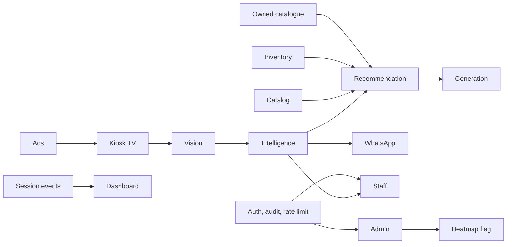

# AuraFit store architecture

The store product is the in-store kiosk for Kasavu & Co. The older social studio stays in place and still uses Clerk. The store surface does not.

## Modules

Each module lives in `src/modules/<name>`. The typed contract is the exported functions and types in `index.ts`. Configuration is the `read*Config` function in the same file. Tests sit beside the module. The demo world in `src/modules/runtime/world.ts` is in memory, so the kiosk runs without Postgres.

| Module | What it does |
| --- | --- |
| vision | One active shopper on the footprints. Capture quality. Session photo memory that forgets on reset and after one hour. |
| generation | Routes adults to GPT Image 2 (`gpt-image-2-2026-04-21`) and synthetic kids to FLUX.2 klein. Night queue pauses while the store is open. |
| recommendation | Six looks. Hard filters, a promote cap, colour diversity. Skin tone stays off the public payload. |
| intelligence | Session rules: three personal try-ons, absence timers, no photo for a child or a gift. |
| catalog | Canonical CSV, barcode shape, photo QA, 95 percent department coverage. |
| inventory | Available, Likely available, Ask staff. The public label never includes a quantity. |
| whatsapp | `wa.me` share link, YES and STOP, two marketing messages a month, phone stored as a hash. |
| staff | Floor, all-staff at 60 seconds, manager at 120 seconds. Xiaomi, Vivo and Oppo checklist. |
| ads | Time and festival playlists. The function does not accept a person. |
| dashboard | Tried-but-not-bought, with barcode-matched sales called out. |
| admin | Brand, store, device. Heatmap refuses to turn on without legal sign-off. |
| analytics | Anonymous zone counts only, and only when the flag and the sign-off are both true. |
| search | Token overlap against the store catalogue. No network. |
| storefront | Hosted product page with Order on WhatsApp and payments off. |
| integration | Excel and Tally stay on the shop LAN. Port 9000 is not exposed. |
| ops | Device health from frame rate, heartbeat, temperature and cache freshness. |
| platform | Mock session cookie in development. Entra when configured. Audit log strips photo and phone fields. |
| runtime | The demo catalogue, the session engine, and the screen copy. |

## HTTP

| Route | Auth |
| --- | --- |
| `POST /api/kiosk/act` | Mock device id in development. Rate limited. |
| `POST /api/auth/session` | Sets an httpOnly HMAC cookie for staff, owner or admin when mock auth is allowed. |
| `GET /api/staff/today` | Staff cookie. |
| `POST /api/staff/missing` | Staff cookie. Writes an audit row. |
| `GET /api/owner/report` | Owner cookie. |
| `GET/POST /api/admin/stores` | Admin cookie. Heatmap enable needs legal sign-off. |
| `POST /api/analytics/heatmap` | Refuses unless the flag and the sign-off are on. |
| `POST /api/whatsapp/inbound` | Mock inbound YES or STOP. The response does not echo the phone. |
| `GET /s/:store/:style` | Public product page. No payment. |

## What stays off

Paid search and Google Shopping are off unless `AURAFIT_ALLOW_PAID_SEARCH` or `AURAFIT_ALLOW_GOOGLE_SHOPPING` is `true`. Cloudinary, Replicate and Gemini need the matching `AURAFIT_ALLOW_*` flag. The default storage provider is Azure Blob. The default try-on provider is `noop`. Photos are not written to disk.
