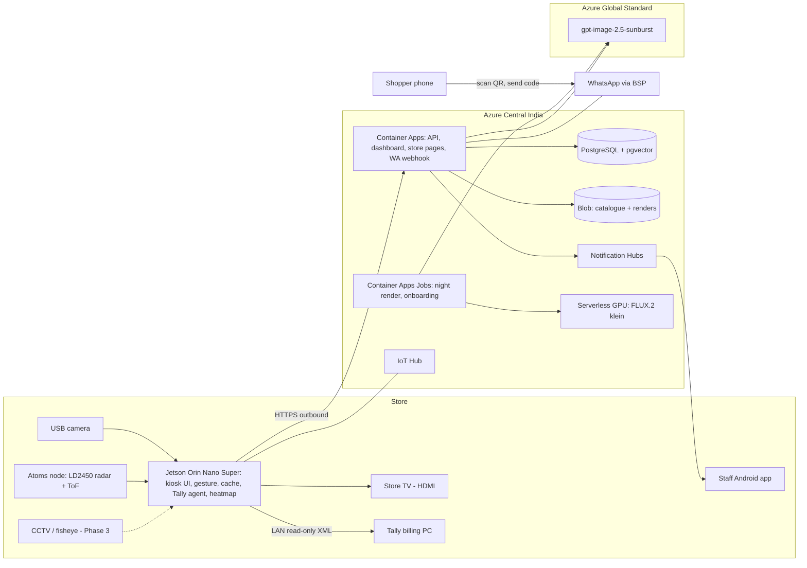
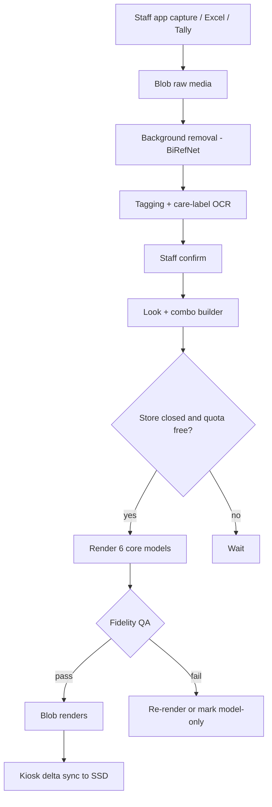

# AuraFit — Complete Product Specification and Pressure Test (v1)

**For:** Goutham, InnoXR Labs (Chennai, IIT Madras-incubated)
**Prepared:** 9 Nov 2026 (IST)
**Status:** Draft v1 for decisions. Nothing has been sent to anyone, and no cloud money has been spent.

**Labels used in this document**
- **[V]** Verified from a source: either a URL given here or one of our research files in `/workspace/aurafit/`.
- **[Est]** An estimate or assumption of ours that still needs to be checked.
- **[D]** One of Goutham's decisions. Followed as given.
- **[RR]** "Recommend revisiting": we think this decision needs another look. It is only flagged and has not been changed.

---

## 0. Executive summary (read this first)

**What AuraFit is.** AuraFit is a virtual try-on screen for Indian clothing stores. It runs on the store's existing TV, with a small box (a Jetson plus the Atoms node) and one camera.
- A shopper raises a hand, answers 3 quick questions and, if they agree, has one photo taken.
- In under 1 second they see six looks from **this store's stock**, worn by a model with a similar body type and skin tone.
- They tap a look to see it on themselves (about 20 s), then take the six looks home on WhatsApp.
- Staff get an alert when a shopper wants help.
- The owner sees which items were tried but not bought, which sizes are missing, and (later) which racks people visit.

**Who pays.** The store owner pays a monthly fee. Shoppers pay nothing.

**Why it can win.** No competitor puts all of these together:
1. it is built for unorganised and regional stores;
2. it runs on hardware the store already has (the TV);
3. it shows only stock the store actually has, with location and availability;
4. it follows up on WhatsApp;
5. it sends staff alerts;
6. it reports tried-but-not-bought items.

Imersive.io (Chennai, smart mirror) and Alaaya are the closest threats.

**What the pressure test changed (top 8)**
1. **The economics are thin at ₹15k a month.**
   - With all 18 models fully pre-rendered and current support costs, an estimated ₹12.8k of the ₹15k goes on costs at 10 stores: about 15% margin [Est].
   - Start by rendering the 6 most common model types and fill in the rest only when a look is asked for. Use remote tools to cut support cost.
   - That brings cost to about ₹9.7k, or about 35% margin [Est].
   - Add a one-time setup fee. We also need to test whether small stores will actually pay ₹15k.
2. **The out-of-stock QR has nowhere to point.** Most unorganised stores have no website. Upgrade: AuraFit hosts a simple product page for each store, and its "Order on WhatsApp" button goes to the store [RR/decision needed].
3. **Image quota is the bottleneck at about 10 stores.**
   - Personal try-ons and the night pre-render job share about 6 requests a minute on `gpt-image-2.5-sunburst`.
   - Pause the night job during store hours and ask Azure for a higher quota early.
   - `gpt-image-2.5-sunburst` retires on 9 Sep 2027. `gpt-image-2` retires on 21 Oct 2027. Microsoft names no replacement. The planned swap is `gpt-image-2.6-sunburst` once Azure lists it. Budget for re-rendering every store, about $10.8k for 100 stores under the 6-model plan [Est].
4. **Kids.**
   - Never train or test on real children's photos without parental consent.
   - At launch, children get looks on synthetic child models only, with no camera photo.
   - A "Shopping for a child" button replaces any age guessing.
5. **Unorganised stores' stock data is weak.** Show only three availability levels (Available / Likely / Ask staff), stated honestly. Build onboarding around a guided phone capture app that also reads the care label to get fabric details.
6. **Staff alerts are unreliable on Indian Android phones** (Xiaomi, Vivo and Oppo battery settings drop pushes). Use high-priority push, a setup checklist, an in-store chime and a WhatsApp fallback, and escalate if nobody acknowledges.
7. **Camera heatmaps are legally grey before DPDP starts in full on 13 May 2027.** Keep the heatmap off until the Indian advocate's opinion arrives. The Atoms node radar is a lower-risk fallback [RR].
8. **The existing TV may be landscape and mounted high**, which spoils full-body framing. Publish mounting rules, and keep a cheap portrait TV as a fallback [RR].

**Recommended plan**
- Weeks 0–2: validation work (lawyer, quota request, pilot store signed).
- Weeks 3–10: an 8-week MVP built by 2–3 engineers.
- Weeks 11–18: a **paid** 60-day pilot in one Chennai store, covering one department of 300–500 styles.
- Then a go/no-go decision against fixed success metrics (Section 6.5).

---

## 1. Overview

### 1.1 Target customer (who pays)

**Primary.** Established single-showroom or small-chain apparel stores in Chennai and Tamil Nadu. They are unorganised or semi-organised, and they:
- carry 1,000–3,000 pieces;
- have at least 80–150 walk-ins a day;
- already use billing software (Tally, GoFrugal, Vyapar, Marg or Zoho) or at least barcodes [Est];
- have an owner who decides fast;
- are worried about Reliance Trends, Zudio, Max and online shopping.

**Why this segment**
- India's apparel retail market was ₹9.30 lakh crore in FY25. 59% of it is unorganised, and the market is expected to reach about ₹16 lakh crore by FY30 [V: CareEdge, https://www.careratings.com/uploads/newsfiles/1768407809_Indian%20Apparel%20Retail%20Market%20to%20Touch%20Rs%2016%20Lakh%20Crore.pdf ; https://www.ibef.org/news/india-s-apparel-retail-market-poised-to-reach-us-193-billion-by-fy30-careedge].
- Tamil Nadu has 67,636 clothing stores, 12,772 of them in Chennai [V: poidata.io, Aug 2025, https://poidata.io/report/clothing-store/india/tamil-nadu].

**[RR] Segment tension.**
- The CEO strategy chat (9 Nov) advised starting with established showrooms and regional chains, not "notebook-run" stores.
- Our recommendation: target the *organised end* of unorganised stores.
- Qualify each one before signing: billing software or barcodes, one staff member who can own the system, and a TV or wall space near the target department.
- Truly notebook-run stores come later, once the catalogue tools are proven.

**Secondary (later).** Regional chains such as The Chennai Silks (24 stores), Pothys and Jeyachandran, where one deal covers many stores; and mall brand stores.

### 1.2 Shopper personas

| Persona | Need | What AuraFit must do |
|---|---|---|
| **Priya, 24, working woman** | Quick office and party looks on a budget | Fast flow, budget filter, WhatsApp to share with friends |
| **Lakshmi, 42, homemaker buying for a family function** | Saree or salwar plus matching items, trust, Tamil | Tamil UI, occasion-first, big easy "Call staff", fabric details |
| **Arjun, 30, buying for himself or a gift** | Doesn't want to browse; wants "what suits me" | Six looks fast, personal try-on for the one he likes |
| **A parent with a child** | Kids' wear; doesn't want the child photographed | "For a child" path using model looks only, no camera photo |
| **A group of friends or family** | Several people want to play | One active user on screen; others join by phone QR |
| **A shy shopper** | Won't be photographed in public | "No photo" path: pick a model manually, still get six looks |

### 1.3 Value proposition

**To the owner**
- "Turn browsers into buyers, and learn what they wanted but didn't buy."
- AuraFit increases conversion through a sense of trying it on, matching sets and staff alerts. It increases basket size through combos, and brings people back through WhatsApp new-arrival messages they have opted into.
- It also turns lost demand into data: the tried-but-not-bought list and the missing-sizes list.

**To the shopper:** "See six looks from this store that suit you in seconds, without changing clothes. Keep them on WhatsApp."

### 1.4 Positioning against competitors (summary of `competitor_analysis.md`)

| Competitor | What they do | Where AuraFit wins | Threat |
|---|---|---|---|
| **Imersive.io** (Chennai) | In-store smart mirror / AR try-on, organised retail | Existing TV (lower hardware cost), stock-aware looks, WhatsApp, tried-not-bought, priced for unorganised stores | **High** (same city) |
| **Alaaya** (TN) | Retail AI / virtual try-on for Indian ethnic wear | Edge hardware, staff alerts, store analytics, no reusable avatar | High |
| **Glance AI** | Consumer AI try-on on phones and TVs | In-store, real stock, store owns the customer | Medium |
| **Fynd GlamAR** | AR SDK / try-on for brands, mostly beauty and accessories | Full-body apparel, unorganised stores, no integration work for the store | Medium |
| **Flickd** | AI styling and try-on for D2C brands online | Physical store, offline mode, hardware included | Low–Medium |
| **StyleUAI** | AI stylist / try-on SaaS | In-store, WhatsApp, inventory and location | Low–Medium |
| **Perch / interactive displays** | Shelf-pickup displays (₹13–31k per display per month) | Try-on, personalisation | Low (price anchor) |
| **Dharpan** | Indian smart mirror (about ₹25k a month for a single store, 2025) | Lower price, uses existing TV | Medium (price anchor) |

**Moat to build (in order)**
1. Stock-aware recommendations backed by availability confidence.
2. The tried-but-not-bought data.
3. WhatsApp opt-in lists owned by the store.
4. Fast onboarding (under a week).
5. The Atoms OS platform (more products on the same box).

---

## 2. End-to-end journeys

### 2.1 Shopper journey (every screen and state)

| # | Screen / state | What the shopper sees | Input | Exit / timeout |
|---|---|---|---|---|
| S0 | **Idle / attract** | Ad loop: store offers, new arrivals on models. Banner: "Stand on the footprints and raise your hand" (Tamil + English) | — | A person stands on the footprints |
| S1 | **Detected** | "Hi! Raise your hand to start" with an animated hand; their pose is outlined; a small phone-QR for others | Hand raised and held for ~1 s in the centre zone | Leaves for 5 s → S0 |
| S2 | **Claimed** | "You're in control." Language toggle: தமிழ் / English | Hand cursor, dwell-select 1 s | 15 s with no one present → reset |
| S3 | **Who is this for?** | Me (Women / Men) / A child / Someone else (gift) | Dwell | — |
| S4 | **Occasion** | Daily, Office, Party, Wedding/Function, Festival, Casual outing | Dwell | — |
| S5 | **Budget** | Store-defined price bands (e.g. under ₹1,000 / ₹1–2.5k / ₹2.5–5k / ₹5k+) | Dwell | — |
| S6 | **Style or colour (optional)** | 4–6 swatches plus "Surprise me" | Dwell or skip | — |
| S7 | **Photo consent** | Short notice: why the photo is taken, deleted at session end, processed in the cloud (outside India), no face recognition. **[Yes, take photo]** / **[No photo — I'll pick a model]** | Dwell | No → S7b |
| S7b | **Pick a model** | 3 body types × 3 tones as neutral "Model A/B/C" thumbnails, no "fair" or "dark" wording | Dwell | — |
| S8 | **Pose guide + countdown** | Outline: "Step back until your feet are in the box." Then 3-2-1, photo | Auto | Quality check fails → retry with a hint (max 2), then S7b |
| S9 | **Six looks** (<1 s) | 6 cards "shown on a model like you": name, price, availability label, rack | Dwell a card | — |
| S10 | **Look detail** | Large image, fabric and care, combo items, sizes with availability labels, "Find it at: Floor 1 › Ethnic › Rack W3". Buttons: **See it on me**, **Call staff**, **Save to phone**, **Back** | Dwell | — |
| S11 | **Rendering on you** (~20 s) | Progress bar plus fabric facts and styling tips; stock-model image meanwhile | — | Over 45 s → "We'll send it to your WhatsApp" |
| S12 | **On you** | Personal try-on with "AI preview; actual fit may vary" | Dwell | — |
| S13 | **Out of stock / size missing** | "This size isn't on the rack right now." **QR → store product page** + **Call staff to check** | Scan / dwell | — |
| S14 | **Save to phone** | QR (wa.me + short code) → WhatsApp opens with "Send my AuraFit looks AF-7K3Q" prefilled | Phone | — |
| S15 | **Call staff** | "Help is on the way. Stay here or go to Rack W3" | — | Staff accepts → "Ravi is coming" |
| S16 | **Still there?** | Shown when the person leaves the zone for 3–5 s | Return / raise hand | 15 s → S17 |
| S17 | **Reset** | "Thank you! Your photo has been deleted." Session wiped from RAM | — | → S0 |

**Kids path (S3 = A child)**
- Skip S7 and S8 entirely, with no camera photo.
- Show kids' stock models (about 4: boy or girl × 2 age bands), age band chosen by the parent.
- WhatsApp save goes to the parent's phone. No tracking and no targeted ads for children (DPDP s.9(3)).

**"Someone else / gift" path:** pick a model (S7b), with no photo.

### 2.2 Staff journey

| # | Moment | Staff app | Kiosk / system |
|---|---|---|---|
| T1 | Morning start | Opens the app (this also pulls any missed alerts) and checks the "Today" card: alerts, missing sizes, new arrivals waiting for photos | Kiosk self-test: camera, network, cache, time; the dashboard turns green |
| T2 | Shopper taps **Call staff** | High-priority push with sound: "Kiosk 1 — customer wants Silk Saree #A231, size M, Rack W3" plus the image. **Accept** | Chime on the kiosk speaker. After 60 s unaccepted → all staff. After 120 s → WhatsApp utility message to the floor manager |
| T3 | Item missing | Tap **Size missing** / **Not on rack** | Availability for the SKU drops to "Ask staff"; logged as lost demand |
| T4 | Sale | Optional **Sold from kiosk** (scan the barcode) | Also matched from the nightly sales file |
| T5 | New arrivals | **Add new item**: scan the barcode → 2–3 guided photos (front, back, care label) → auto-tag → confirm | Overnight: background removal, tagging, render on the core models |
| T6 | Rack move | **Move items**: scan the rack QR, then scan the items | Location updated |
| T7 | Evening | — | Sales and stock file (Tally agent automatically, or Excel upload). Night render after closing |

### 2.3 Owner journey
1. **Weekly WhatsApp summary** (utility template), e.g. "This week: 412 sessions, 63 WhatsApp saves, top tried-not-bought: Blue Kurta #K112 (31 tries, 2 sales), size M missing in 9 styles."
2. **Dashboard** (web/mobile): tried-not-bought, missing sizes, staff response times, heatmap (after legal sign-off), idle-ad schedule, WhatsApp subscribers, new-arrival broadcast (opted-in only).

### 2.4 Edge cases

| Edge case | Design |
|---|---|
| **Crowd in front of the screen** | Only the person on the footprints, in the centre zone and above the size threshold, can claim control. Others are ignored and see "Join on your phone" (QR to a phone mini-flow with model looks only) |
| **Two people raise hands** | The first to hold for 1 s wins; ties go to whoever is closest to the centre and largest |
| **Kids playing with the screen** | Small bodies under the size threshold can't claim. There is no photo without the consent screen, and the "For a child" path takes no photo [Est: the size threshold isn't a reliable age control; the consent flow is the real control] |
| **Bad lighting / backlight** | Fill light included. Capture quality check (exposure, blur, full body) retries ×2, then pick-a-model. Skin tone uses a fixed grey card at the kiosk for white balance. When unsure, the middle tone, plus "change model" |
| **No internet** | Pre-renders are cached on the SSD, so S0–S10 work offline. Personal try-on is disabled ("needs internet"). WhatsApp save still works: the QR carries a signed short code encoding the store and look IDs, so the cloud can answer even if the kiosk never syncs. Staff alerts go over store Wi-Fi (LAN push) and the chime. Events are queued and synced later |
| **Power cut** | A 600VA UPS keeps the Jetson and router up for an estimated 10–20 min. When power returns, the TV wakes automatically and a heartbeat alert goes to InnoXR |
| **Out of stock / size missing** | Label, QR to the product page, "Call staff to check", lost demand logged |
| **Shopper walks away mid-session** | "Still there?" after 3–5 s, reset after ~15 s, photo deleted. An in-progress render is discarded unless the WhatsApp QR was already scanned (then it is sent there) |
| **Saree pallu, dupatta, burqa, unusual pose** | Body-type matching falls back to pick-a-model. No face crop is required: skin tone comes from the hand or neck if visible, otherwise a default |
| **Different size or colour wanted** | Variants are shown with labels. Items unseen in 14 days show "Available on request — staff will check" |
| **Misuse (rude gestures, repeated photos)** | Max 3 personal renders per session, 1 session per 2 minutes per footprint. The content filter is on |
| **Content filter blocks a try-on** | Show the model image: "We can't preview this item on you; here it is on a model." Lingerie and swimwear are model-only by default |
| **Render fails / quota hit (429)** | Queue it, and "we'll WhatsApp it to you". Over 45 s, switch to async |
| **Camera disconnected** | Switch to no-photo mode automatically and alert InnoXR |
| **Store closes** | TV sleeps via HDMI-CEC and the night job runs |

---

## 3. Modules (purpose · how it works · competitors · pressure test · upgraded design)

### 3.1 Kiosk UI and gestures

**Purpose.** A touch-free, crowd-safe controller for a TV the shopper can't touch.

**How it works**
- **Runtime:** a local web app (Next.js static build) in Chromium kiosk mode on the Jetson, HDMI to the TV. A local Python service (FastAPI + WebSocket) owns the camera and sends gesture events.
- **Pipeline:**
  - a 640×360 tracking stream;
  - a person detector (D-FINE-S or RF-DETR-N, Apache-2.0) with ByteTrack (MIT);
  - MediaPipe Pose (num_poses 3–4) to find the active user;
  - MediaPipe Hand Landmarker for the cursor;
  - a One Euro filter for smoothing;
  - dwell-select at 1 s, open palm = back.
- **Claim rule [D]:** standing on footprints about 1.2 m from the screen, in the centre zone, above the size threshold, with a hand raised for about 1 s.
- "Still there?" after 3–5 s; reset after about 15 s (photo deleted).
- **Reuse:** demo branch `cursor/autofit-igdc-stall-0b54` already has `useHandInput.ts` (browser HandLandmarker, One Euro, dwell-click, drag, scroll). Missing: the pose-based active-user lock, and moving the work to the Jetson service.

**How competitors do it.** Smart mirrors (Imersive, Dharpan) use touch. Some use depth sensors or Ultraleap. Glance on TV uses the remote.

**Pressure test**
- Dwell is slow across many screens.
- Hands are lost when a shopper holds bags or a phone.
- Uneven store light.
- Landmark jitter at 1.2–2 m on a 640×360 stream.
- The heatmap job can steal frame rate.
- Older shoppers may not understand gestures.

**Upgraded design**
1. At most 4 decisions before six looks (S6 is optional).
2. At most 6 large tiles per screen, each at least 15% of the screen width.
3. **Assist mode:** after 10 s with no select, show "A staff member can guide you", with a remote control in the staff app.
4. **Hand-ROI upscaling:** crop the hand region from the full-resolution frame.
5. **Phone-as-controller:** the S1 QR lets the shopper drive the same session from their phone. This solves bags in hand and shyness.
6. **Performance budget:** gesture loop at ≥ 20 fps p95, with priority over heatmap (which uses snapshots).
7. **Kept [D]:** a single RGB camera, no depth sensors or Ultraleap.

### 3.2 Camera and photo capture

**Purpose.** One good full-body photo, only after consent, deleted at session end.

**How it works**
- Logitech Brio (wide mode preferred) or C920, USB, mounted top-centre of the TV and angled down [Est: confirm FOV in the pilot].
- After 3-2-1, take a burst of 3 full-resolution frames and keep the sharpest.
- **Quality checks:** head and feet visible, blur (Laplacian variance), exposure, a single person.
- **Handling:** held in RAM only, sent over TLS only when "See it on me" is tapped. The cloud copy is deleted right after the render (max 1 h), the kiosk copy at reset.

**How competitors do it.** Built-in mirror cameras, often with stored profiles. Glance uses a selfie plus a stored avatar. We rejected the reusable avatar [D].

**Pressure test**
- High-mounted TVs put the camera too high, so the shopper's legs look short.
- Mirror-image confusion.
- Backlight from the store entrance.
- "Always-on camera" fears.

**Upgraded design**
1. **Mounting rules:** TV bottom edge at about 0.9–1.0 m, camera at about 1.5–1.7 m, footprints at 1.2 m, with a 5-minute calibration wizard.
2. A camera LED plus an on-screen note: "Camera: tracking only, no recording". A shutter when the store is closed.
3. **Consent before the photo [D]:** Tamil + English, with a QR to the full notice.
4. No raw video stored anywhere.

### 3.3 Body-type and skin-tone matching

**Purpose.** Choose the nearest of the 18 adult stock models so the first six looks feel personal in under 1 s.

**How it works**
- **Body type (3 buckets):** pose-landmark shoulder:hip and waist-proxy ratios.
- **Skin tone (3 buckets):** sample the face, neck or hand after grey-card white balance, then CIELAB, mapped to buckets anchored on Monk Skin Tone scale ranges (Google, CC-BY 4.0) [Est: boundaries tuned in the pilot].
- **Gender for model choice** comes from the shopper's own tap on S3, never inferred [D].
- **Output:** model_id only; the measurements are discarded.
- **[D]** Skin-tone ranking is an internal background process and is never shown.

**How competitors do it.** Avatars (Glance), or no matching at all (flat product images on most mirrors).

**Pressure test**
- **Colourism:** any visible "fair/dark" labelling would be harmful and bad PR.
- Store LEDs shift colour.
- **Legal:** photo-derived traits may count as sensitive under the SPDI Rules, and cross-store aggregation could make AuraFit a data fiduciary.
- Loose clothing hides body shape.

**Upgraded design**
1. Never show the bucket. Always offer **"Change model"** with neutral thumbnails.
2. Compute on the Jetson only. Keep model_id, never the measurements.
3. No cross-store skin-tone dataset for AuraFit's own use.
4. Disclose it in the notice: "we pick a similar model; nothing is stored".
5. When confidence is low, use the middle bucket.

### 3.4 Catalogue and SKU onboarding

**Purpose.** Get 300–3,000 styles in with photos, attributes, prices, sizes and locations, fast, even with no digital catalogue.

**How it works**

*Sources, in order of preference:*
1. Billing-software export or API.
2. The AuraFit Excel template.
3. Staff-app capture.

*Guided capture (Android):*
1. Scan the barcode (or print AuraFit QR tags if there is none).
2. Front photo against a foldable grey backdrop with a clip-on light.
3. Back photo.
4. Care-label photo.

*Cloud processing:*
- background removal with BiRefNet (MIT) on Container Apps;
- attributes (category, colour, pattern, sleeve, neckline, occasion) and fabric OCR from the care label via a small Azure OpenAI vision model;
- staff confirm by swipe.

*Combos:* proposed nightly by rules (category compatibility, colour harmony, price band). An LLM only suggests, and rules validate.

**How competitors do it.** Online-first tools (Flickd, StyleUAI, GlamAR) expect clean e-commerce feeds. Mirror vendors set up catalogues manually over weeks.

**Pressure test**
- No fabric, size or location data.
- Sarees and dupattas photograph badly on hangers.
- Many colour duplicates.
- Uneven photo quality.
- 500 styles × 1.5 min ≈ 12.5 h of capture [Est].

**Upgraded design**
1. **Style ≠ SKU:** one style, many variants (colour × size). Photograph one per colour, not per size.
2. **≤ 45 s per style** with the overlay and auto-capture when steady. 500 styles ≈ 6–7 h for 1 person, or 2 people × ~1 day plus 2 h review [Est].
3. **Sarees:** a drape stand or mannequin template.
4. **Fabric:** OCR, then staff confirm, or a pick-list if there is no label.
5. **Quality gate:** low-QA photos are re-shot before leaving the store.
6. **Go-live gate:** ≥ 95% coverage of the pilot department (CEO chat).

### 3.5 Overnight pre-render

**Purpose.** Show the first six looks in under 1 s, already worn by a model like the shopper.

**How it works [D]**
- **Stock models:** about 18 adults (2 genders × 3 body types × 3 tones) plus about 4 kids' models.
- **Generation:** Azure OpenAI `gpt-image-2.5-sunburst` (version 2026-09-09, deployment name `AURAFIT_IMAGE_MODEL`) for adults. FLUX.2 klein 4B (Apache-2.0, fine-tuned) for kids and as the fallback. Direct OpenAI is not used.
- **Job:** a Container Apps Job finds new or changed looks, renders look × model pairs, runs QA, writes to Blob. The kiosk syncs the delta to its SSD before opening.
- **Scale (decisions file, estimates):** 500 SKUs → about 5,400 images, about $325 once and about $36 a month. A first full render takes about 15 h at 6 RPM.
- The plan as written: about 100 curated looks.

**How competitors do it.** Render on demand (slow, costly), or show flat product images.

**Pressure test**
1. **Coverage:** about 100 looks, filtered by occasion × budget × size × availability, leaves only a few per filter, so shoppers see repeats.
2. **Cost:** the 18-model pre-render is the largest variable cost, about ₹3.2k a month per store [Est].
3. **Quota:** 15 h doesn't fit in one night of about 10 closed hours.
4. **Retirement:** `gpt-image-2.5-sunburst` leaves Azure on 9 Sep 2027. `gpt-image-2` leaves on 21 Oct 2027. Microsoft names no replacement, so everything must be re-rendered with the next model Azure lists. The planned swap is `gpt-image-2.6-sunburst`.
5. **Fidelity:** embroidery, saree borders and prints can drift. A wrong garment destroys trust.

**Upgraded design**
1. **6 core models first** (the most common body type × tone per gender, chosen from pilot data). The other 12 are rendered **on demand** the first time they are needed (the nearest core model shows meanwhile), then cached.
   - Cost: about ₹1.1k a month top-up and about ₹9.5k one-off per store [Est].
   - The 18-model design stays the target [D]; only the order changes.
2. **Bigger look pool:** every in-stock style is at least one look, plus combos.
3. **Fidelity QA:** reject renders where garment-embedding similarity falls below a threshold. Staff spot-check 20 renders a week.
4. Run only when the store is closed. Pause whenever a kiosk needs a live render.
5. **Pin `model_version` on each render.** The pinned default is `gpt-image-2.5-sunburst` (2026-09-09). Budget for re-rendering before 9 Sep 2027: about $10.8k for 100 stores at 6 models, or about $32.4k at 18 [Est].
6. **Label [D]:** "Shown on a model like you."

### 3.6 Live personal try-on

**Purpose.** The "wow": the tapped look on the shopper's own photo, in about 20 s.

**How it works**
- The kiosk sends the photo and garment images to Azure OpenAI, which calls `gpt-image-2.5-sunburst` edit at medium quality (about $0.05 per image, about ₹4.4 [Est, carried from the previous model until Sunburst rates are confirmed]).
- The result goes back to the kiosk and the cloud input is deleted.
- **Fallback:** FLUX.2 klein 4B with `xocialize/tryon-FLUX.2-klein-4B-lora` on Azure Container Apps serverless GPU (A100 about ₹254/h [V: Azure retail prices API]).

**How competitors do it.** Glance and Flickd use diffusion try-on on selfies. Mirror vendors use AR overlay or 3D.

**Pressure test**
- 20 s feels long when standing.
- **Content policy:** swimwear has medium block risk, lingerie high.
- **Data leaves India.** There is no Central India region confirmed for `gpt-image-2.5-sunburst`, and the 30-day abuse-monitoring retention is unverified.
- **Quota:** Saturday peaks across 10 stores could exceed 6 RPM.

**Upgraded design**
1. **Fill the wait:** fabric facts, matching items, and "Call staff to bring your size now".
2. Over 45 s, it switches to async and arrives on WhatsApp.
3. Cap at 3 personal renders per session.
4. Model-only categories: lingerie, swimwear, kids.
5. **Data:** say "processed on Microsoft Azure outside India" in the notice. Apply for modified abuse monitoring and get Microsoft's retention terms in writing.
6. **Quota:** request an increase before store #5. Priority order: live > on-demand > night.

**[RR] Kids personal try-on.**
- The decision says klein covers kids.
- Recommend klein renders **synthetic child models only**.
- Real-child photo try-on needs verifiable parental consent (DPDP Rules, from 13 May 2027) and is a high reputational risk.
- Defer it until a lawyer approves a parental-consent flow.

### 3.7 Recommendation and combo engine

**Purpose.** Six looks that are suitable, available and varied, and that the store wants to sell.

**How it works**
1. **Hard filters:** for whom, occasion, budget, availability (Available or Likely first), size if known.
2. **Scoring (weights tuned in the pilot):**
   - occasion and style rules;
   - colour compatibility with the internal tone bucket [D];
   - popularity and tried-not-bought learning;
   - store priority (new arrivals, overstock);
   - optional margin.
3. **Diversity:** MMR over embeddings (SigLIP, Apache-2.0, or the repo's pgvector), so you don't get six blue kurtas.
4. **Combos:** pre-paired nightly. The LLM suggests and the rules approve. The LLM never invents products.
5. **Speed:** runs on the Jetson from the cache in under 200 ms [Est].

**How competitors do it.** Online stylists use LLM chat or profiles. Mirrors use plain browse.

**Pressure test**
- Cold start with no sales data.
- Wrong availability (CEO target: ≥ 90% correct).
- The owner wants to push old stock.

**Upgraded design**
1. Rules first. Learning after 4 weeks of events.
2. A "Promote this style" toggle, capped at 2 of the 6 slots.
3. Never put an Unconfirmed item in slot 1.
4. Log the reason for every pick, for debugging.

### 3.8 WhatsApp

**Purpose.** The shopper takes the looks home, and the store gets a consented contact.

**How it works [D]**
1. The QR opens wa.me with a prefilled code.
2. The shopper's message opens the 24-hour window.
3. We reply with the looks plus "Reply YES for new arrivals from <Store>".
4. Only YES contacts get marketing messages.

**Prices [V]**
- Meta: ₹0.8631 marketing, ₹0.115 utility. Service messages are free in the window, with the first 1,000 per number per month free.
- AiSensy: ₹1.09 marketing, ₹0.145 utility. Plans ₹1,500 / ₹3,200 / ₹9,100 a month (https://aisensy.com/pricing).

**How competitors do it.** BSPs (Gupshup, Interakt, AiSensy) handle receipts and campaigns. No try-on player links try-on to an opt-in (`whatsapp_competitor_research.md`).

**Pressure test**
1. A WhatsApp Business account per store needs Meta business verification each time, which is heavy.
2. 6 images = 6 messages, a cluttered chat.
3. On a shared number, one store's spam reports hurt every store.
4. Proof of opt-in is required.

**Upgraded design**
1. **MVP:** one AuraFit number that names the store in every message. Per-store numbers come later for chains.
2. **Send 1 collage plus 1 link** to an expiring 7-day gallery [Est] on the AuraFit store page.
3. Max 2 marketing messages per contact per store per month. One-tap STOP.
4. **Consent ledger:** timestamp, store, wording version.

### 3.9 Out-of-stock QR

**Purpose [D].** When an item or size is out, still show the dress, with a QR to the store's product page.

**Pressure test.** Most unorganised stores have **no website**.

**Upgraded design [RR — decision needed]**
1. AuraFit hosts a light store page at `aurafit.in/s/<store>/<style>` [Est domain]: images, fabric, price, sizes, address, opening hours.
2. An **"Order / reserve on WhatsApp"** button messages the store's own WhatsApp with the style code.
3. No payment goes through AuraFit (consistent with "no pay at kiosk" [D]).
4. If the store has Shopify or WooCommerce, the QR deep-links there instead.
5. Scans are logged as lost demand.

### 3.10 Staff app and alerts

**Purpose.** Reliable "customer needs help" alerts, plus stock and catalogue tasks.

**How it works**
- Android first (Flutter or React Native).
- OTP login over a WhatsApp authentication template.
- Push via FCM through Azure Notification Hubs (free tier).
- **Features:** alerts (accept / done), Size missing, Not on rack, Sold from kiosk, Add item, Move rack, Render spot-check, assist-mode remote.

**Pressure test**
- Xiaomi, Vivo and Oppo battery managers delay or kill pushes [V: https://dontkillmyapp.com/xiaomi ; https://signops.dev/blog/push-notifications-xiaomi-oppo-vivo/].
- Shared phones.
- Busy staff ignore alerts.

**Upgraded design (layered reliability)**
1. High-priority FCM *notification* messages on a dedicated sound channel.
2. A first-run checklist per phone brand (autostart, no battery limit, lock in recents).
3. Pull-on-open plus a sticky "Today" card.
4. A kiosk chime plus "Help is coming" on screen.
5. **Escalation:** 60 s → all staff; 120 s → WhatsApp utility message to the manager (₹0.145).
6. Optional counter tablet or speaker [Est ₹2–3k].
7. **Target:** acknowledged within 2 minutes p90.

### 3.11 Inventory

**Purpose.** Know what is likely on the floor, without building an inventory system (CEO chat: connect, don't build).

**How it works [D]**
- **Now:** barcodes, the nightly sales or stock file, and the staff "size missing" button.
- **Phase 2:** RFID tags at ₹6–8 each plus a Chainway C72 reader (about ₹70–79k), about ₹1–1.1 lakh total.
- Items unseen for 14 days show "Available on request — staff will check".
- **Labels:** Available / Likely available / Unconfirmed. No stock count shown [D].
- **Location:** floor › section › rack, via rack QR stickers.

**Upgraded confidence rules [Est]**
- **Available:** stock > 0 in the latest file, AND no missing tap in 3 days, AND seen or scanned within 14 days.
- **Likely:** stock > 0 but unseen for 14 days, or the last piece.
- **Unconfirmed / Ask staff:** a missing tap, a file older than 3 days, or never seen.

**Pressure test:** files arrive late, Tally stock is often wrong, and staff forget to tap.

**Upgraded**
- File freshness on the dashboard, plus a WhatsApp nudge to the owner after 2 days.
- Missing taps counted on a staff leaderboard.
- Rack monitoring (3.12) as an independent signal.

### 3.12 Heatmaps and rack monitoring

**Purpose.** Show anonymous footfall and dwell by zone, and spot empty racks.

**How it works [D]**
- Runs on the Jetson using store CCTV, or one 5MP fisheye (CP Plus CP-UNC-EE51L1C-VMD, about ₹18k) plus 2–4 angled 4MP domes (about ₹4.2–4.9k each).
- **Pipeline:** NVDEC decode (7× 1080p H.264), then a detector (D-FINE-S / RF-DETR-N / RT-DETRv2 / YOLOX, Apache-2.0) with ByteTrack and supervision (MIT), then floor homography, zone counts and dwell.
- Rack snapshots every 5 minutes feed a fullness classifier.
- **Only aggregates leave the device.**
- No Ultralytics (AGPL) and no YOLO-NAS.
- **Cost:** about ₹25–45k per store, or ₹12–20k if existing CCTV covers the walls [Est].

**Coverage [V: fisheye_rack_visibility.md].** Good for heatmaps and centre rails, marginal for wall racks, poor for low shelves.

**Legal [V].**
- Harvey: "NOT a clean yes". An Indian advocate's opinion is needed first.
- No face recognition and no age or gender inference.
- Tamil + English signage.
- The store is the fiduciary and AuraFit the processor.

**Pressure test**
- An 8 GB Jetson running the UI, gesture and 4–5 streams is tight.
- Legal uncertainty.
- Crowded aisles reduce accuracy.
- Owners may want staff surveillance, which is out of scope and risky.

**Upgraded design**
1. **Phase 3 only, after the lawyer's opinion.**
2. Low frame rate or snapshots, not full video, to protect gesture performance.
3. Contractually ban staff monitoring.
4. **[RR] Fallback:** Atoms node LD2450 radar / ToF counts (no images) if camera heatmaps are refused.
5. Join zones to tried-not-bought for "attention vs sales" per section.

### 3.13 Idle ads

**Purpose [D].** Use idle screen time and attract the next shopper.

**How it works.** A playlist scheduled in the dashboard:
- store offers;
- new arrivals on models (reusing the pre-renders);
- festival campaigns (Pongal, Deepavali, the wedding season);
- later, supplier or brand ads.

The attract overlay stays on.

**Pressure test.** Irrelevant ads annoy. Camera-targeted ads would break the no-inference rule and s.9(3).

**Upgraded**
- Context only (time of day, festival), never camera targeting.
- ASCI-compliant content.
- Later, a supplier ad revenue share to offset the fee [Est].

### 3.14 Dashboard and reports

**Purpose.** Prove ROI and give the owner actions to take.

**Main report [D]: tried but not bought**
- Per style: shown → opened → personal try-on → WhatsApp saved → staff called → sold (nightly file or Sold tap).
- **"Tried"** = opened detail or personal try-on.
- **Actions:** reprice, restock the size, move the rack, promote.

**Other reports**
- missing-size demand;
- out-of-stock QR scans;
- sessions per hour vs footfall;
- staff response;
- WhatsApp subscribers and broadcasts;
- uptime;
- heatmap (Phase 3).

**Pressure test.** Owners don't open dashboards, and attribution is weak without POS data.

**Upgraded**
- **WhatsApp-first weekly summary.**
- Attribution labelled "barcode-matched" vs "estimated".
- Baseline comparison (pre-pilot weeks, or the same period last year).

### 3.15 Admin and multi-store

- **Tenants:** Brand → Store → Device.
- **InnoXR console:**
  - setup wizard, fleet health;
  - catalogue QA queue, render queue and quota;
  - model versions, feature flags (heatmap per store only after legal sign-off);
  - billing, support tickets.
- **Chain admin:** shared catalogue with per-store stock and location.
- **Rule (CEO chat):** no per-retailer customisation of Atoms OS; configuration only.

### 3.16 Billing and pricing

**Anchors [V]**
- Dharpan about ₹25k a month for a single store (2025).
- Perch ₹13–31k per display per month.
- Shopify POS Pro ₹7k a month.
- Pitch deck PaaS ₹15–30k per device per month.

**Goutham's idea [D-in-progress].** ₹15k a month plus 3–5% of attributed sales.

**Pressure test**
- A percentage of sales needs attribution the owner trusts, so expect disputes. A percentage of profit is unworkable.
- Margin at ₹15k is about 15% (full render) or about 35% (upgraded) at 10 stores [Est].
- ₹15k may be high for small stores [Est].

**Upgraded proposal (all Est, to validate in owner interviews)**
- Setup fee ₹25–40k, or a hardware deposit.
- **About ₹12–15k per kiosk a month.**
- Heatmap and rack add-on +₹3–5k. Extra kiosk +₹8–10k.
- **[RR]** Replace 3–5% of all attributed sales with a capped 2–3% on **barcode-matched** kiosk sales.
- Paid pilot (CEO chat: never free).
- Razorpay subscriptions (already in the repo) with GST invoices.

### 3.17 Integration (POS, Excel, Tally, website)

**Tally**
- TallyPrime serves XML over HTTP on port 9000 with **no authentication** [V: https://help.tallysolutions.com/xml-integration/ ; https://docs.intelligent.page/connectors/tally].
- **Design:** an AuraFit agent on the Jetson (same LAN) sends read-only XML requests for stock items and daily sales vouchers and pushes them out over HTTPS. **Never expose port 9000.**

**Others**
- GoFrugal and Zoho Inventory: REST APIs.
- Vyapar and Marg: Excel/CSV export, so use the template upload (staff app, email-in, or a watched folder) [V: atoms POS/ERP research].

**Website.** Shopify / WooCommerce product URL mapping for the out-of-stock QR, and optional import.

**Pressure test.** Every store is different, and integration work can kill onboarding time.

**Upgraded**
- One canonical CSV schema: style, variant, barcode, price, size, colour, stock, location.
- Every connector maps into it.
- **MVP connectors: Excel + Tally only.**

### 3.18 Hardware

| Item (per kiosk) | Price | Source |
|---|---|---|
| Jetson Orin Nano Super 8GB + NVMe SSD | ≈ ₹37,700 | [V] ₹34,679 robu.in plus SSD |
| Camera: Brio class / C920 | ₹14–20k / ₹7,995 | [V/Est] |
| Fill light | ≈ ₹4,500 | [Est] |
| UPS 600VA | ≈ ₹5,000 | [Est] |
| Mount, cables, floor decal, grey card | ≈ ₹4,000 | [Est] |
| Atoms node (ESP32 + HLK-LD2450 + VL53L1X) | ≈ ₹4,000 | [V: internal] |
| 4G backup router + SIM | ≈ ₹4,000 + ₹300 a month | [Est] |
| **Total without TV** | **≈ ₹76,200** (≈ ₹67,195 with a C920) | [Est] |
| Heatmap kit (optional) | ₹12–45k | [Est] |

- **Power:** the Jetson draws about 15 W, ₹114–191 a month at TN's ₹10.45/kWh [V].
- **Existing TV [D]:** needs HDMI, CEC and the right height. **[RR]** A fallback 43–50" TV if not.
- **Atoms node:** radar wake-up, ToF footprint distance check, and a future low-risk counter. **Never used for gesture** [D].
- **Note:** earlier research said an i5 mini PC is enough. Goutham chose the Jetson [D], which makes sense once heatmaps share the box.

**Pressure test.** Chennai heat and dust, power cuts, theft, one box doing everything.

**Upgraded**
- A ventilated lockable enclosure.
- A watchdog with auto-restart.
- 1 spare kit per 10 stores.
- Profile memory in the pilot. A second Jetson for heatmaps if needed.

### 3.19 Azure cloud architecture (AuraFit is on Azure only [D])

| Component | Azure service | Notes and price [V: Azure Retail Prices API, Central India] |
|---|---|---|
| API, dashboard, store pages, WhatsApp webhook | Container Apps (Central India) | vCPU active ₹0.0023/s; ₹38 per million requests |
| Database | PostgreSQL Flexible + pgvector | B1MS ≈ ₹1,703 a month (pilot); B2s ≈ ₹6,813 a month later |
| Images | Blob Storage (Central India) | Negligible at pilot scale |
| Queue and jobs | Storage Queue / Service Bus + Container Apps Jobs | Night render, onboarding |
| Adult generation | Azure OpenAI `gpt-image-2.5-sunburst` | **Outside India**; about 6 RPM default |
| Kids / fallback generation | Container Apps serverless GPU A100 (≈ ₹254/h) + FLUX.2 klein | Scales to zero |
| Tagging / OCR | Small Azure OpenAI vision model | Small per call [Est] |
| Devices | IoT Hub, Free → S1 (₹3,333 a month) | Certificates, twins, OTA |
| Push | Notification Hubs (Free) + FCM | |
| Secrets / monitoring | Key Vault; Azure Monitor + App Insights | |

**Repo reuse.** Main has Next.js 15, Prisma, Postgres with pgvector, Azure OpenAI, Bicep for Container Apps, and Razorpay.

**[RR] Repo conflicts with the rules**
- The repo uses Clerk, Cloudinary, Replicate, Gemini and SerpAPI / Google Shopping (D-003 defaults them to on). This conflicts with the Azure-only and no-paid-search rules.
- For the store product:
  - Blob instead of Cloudinary;
  - Azure-hosted klein instead of Replicate;
  - Entra External ID or our own OTP instead of Clerk [Est];
  - SerpAPI off.

### 3.20 Data model (core entities)

- **Tenant:** `Brand`, `Store`, `StoreLocation` (floor › section › rack).
- **Devices:** `Device` (Jetson + Atoms node, certificate, version), `DeviceHeartbeat`.
- **Catalogue:** `Style`, `Variant` (barcode, size, colour, price), `Media` (front/back/label, QA score), `FabricInfo`.
- **Stock:** `StockSnapshot` (variant, qty, source, file_time), `StockSignal` (missing tap, seen, rack fullness), `Availability` (label + reason).
- **Looks:** `Look`, `LookItem`, `StockModel` (gender, body bucket, tone bucket, version), `Render` (look × model, image model + version, QA, blob).
- **Sessions (anonymous):** `Session` (store, device, times, for_whom, occasion, budget, model_id, photo_consent; no photo stored), `SessionEvent` (`look_shown`, `look_opened`, `tryon_requested`, `tryon_done`, `qr_scanned`, `staff_called`, `product_selected` …, each with store_id, session_id, sku and ts, as in the CEO example).
- **WhatsApp:** `ShareCode` (signed → look IDs), `Contact` (phone hash + encrypted phone, store), `ConsentRecord` (purpose, wording version, ts), `MessageLog`.
- **Staff:** `StaffUser`, `Alert` (created, accepted_by, accepted_at, escalated), `TaskLog`.
- **Analytics:** `ZoneCountHourly`, `RackFullness`, `TriedNotBoughtDaily`.
- **Ads and billing:** `AdCampaign`, `AdSchedule`, `Subscription`, `Invoice`.

**Retention [Est, confirm with the lawyer]**
- Photos: session only, and ≤ 1 h in the cloud.
- Personal renders: deleted after delivery, or kept in a 7-day gallery.
- Anonymous events: 24 months.
- Contacts: until STOP, plus 30 days.

### 3.21 Security

- **Device:**
  - LUKS disk encryption, plus secure boot where JetPack supports it [Est];
  - a per-device X.509 certificate (IoT Hub);
  - **no inbound ports**;
  - signed container updates;
  - remote access only through an audited managed tunnel.
- **Tally:** LAN agent only. Port 9000 is never exposed.
- **Cloud:**
  - Key Vault and managed identities;
  - private endpoints for the database at 10+ stores;
  - RBAC per store, staff and owner;
  - audit logs;
  - OWASP review and a pentest before 10 stores.
- **Data:** TLS everywhere. Phone numbers are encrypted, with a separate lookup hash. No raw video. Photo deletion is verified by a daily job.
- **Kiosk:** rate limits, the content filter, and no free-text input.

### 3.22 Privacy and legal (India)

- **Timeline [V]:**
  - DPDP Rules notified 13 Nov 2025; the main duties start 13 May 2027.
  - Until then, IT Act s.43A and the SPDI Rules apply, and they treat biometrics as sensitive.
- **Roles:** the store is the Data Fiduciary, AuraFit the Processor (DPA contract). Using cross-store data for our own purposes could make AuraFit a fiduciary, so avoid that.
- **Children:** verifiable parental consent for under-18s, and no tracking or targeted ads (s.9(3)). Hence the no-photo kids path.
- **Requirements [D]:** a Tamil + English notice, opt-in before the photo, no face recognition, no age or gender inference.
- **Cross-border:** `gpt-image-2.5-sunburst` processes photos outside India, so disclose it [Est: confirm the transfer position with the lawyer].
- **CCTV:** TN's 2012 rules require entrance CCTV at shops of 500 m² or more [V]. Reusing it for analytics still needs notice.
- **Before the pilot:**
  1. Advocate's opinion (via the iTNT lawyer) on the photo flow, the heatmap and the WhatsApp opt-in.
  2. A DPA template.
  3. The privacy notice.
  4. Microsoft retention terms in writing.

### 3.23 Monitoring and ops

- **Signals:**
  - heartbeat every 60 s; camera fps; gesture success;
  - cache sync;
  - render p50/p90, 429s, content blocks;
  - WhatsApp delivery; alert ack time;
  - stock-file freshness; disk and temperature.
- **Alerts:** to the InnoXR on-call.
- **SLA [Est]:** remote fix within 4 business hours; Chennai kit swap the next business day.
- **Runbooks:** camera lost, TV off, no internet, render backlog, quota, bad renders, alert failures.
- **Weekly ops review.**

---

## 4. Whole-product pressure test

### 4.1 Unit economics per store (all [Est]; computed in Python; FX ₹88/$)

**Assumptions**
- 600 sessions a month (20 a day); 50% tap a look; 1.3 personal renders each, so about 390 renders at about $0.05.
- 30% scan WhatsApp and 40% of those say YES, giving about 430 subscribers by month 6, each sent 2 alerts a month.
- Hardware ₹76,200 over 36 months.

| Monthly cost | A: full 18-model pre-render, support ₹3k | B (upgraded): 6 core models + on-demand, support ₹2k |
|---|---|---|
| Hardware amortisation | ₹2,117 | ₹2,117 |
| Power (Jetson + light) | ₹225 | ₹225 |
| Pre-render top-up | ₹3,168 | ₹1,056 |
| Personal try-ons (~390) | ₹1,716 | ₹1,716 |
| LLM tagging / curation | ₹300 | ₹300 |
| Shared cloud per store (10 stores) | ₹650 | ₹650 |
| WhatsApp service + marketing | ₹1,015 | ₹1,015 |
| BSP plan share (Pro ÷ 10) | ₹320 | ₹320 |
| 4G backup SIM | ₹300 | ₹300 |
| Support | ₹3,000 | ₹2,000 |
| **Total, 10 stores** | **≈ ₹12,811 (≈ 15% margin at ₹15k)** | **≈ ₹9,699 (≈ 35%)** |
| Total, 1 store | ≈ ₹18,041 (loss) | ≈ ₹14,929 (break-even) |
| Total, 100 stores | ≈ ₹12,232 (≈ 18%) | ≈ ₹9,120 (≈ 39%) |

**One-time cost per store**
- Hardware ₹67–76k (+₹12–45k for the heatmap kit).
- First render: ₹28.6k for 18 models, or ≈ ₹9.5k for 6.
- Onboarding: 2 people × 2 days.

**Payback (B, no setup fee):** (₹76.2k + ₹9.5k) ÷ (₹15k − ₹9.7k + ₹2.1k amortisation added back) ≈ 11–12 months. **This is why a setup fee or deposit is recommended.**

**Sensitivity:** doubling sessions to 1,200 a month raises the try-on cost to about ₹3.4k, about 11 points of margin. Hence the per-session cap and a lower-quality option.

### 4.2 The "near-zero ongoing work after first creation" goal

| Ongoing task | Who | Effort [Est] | Can it be near-zero? |
|---|---|---|---|
| Photograph new arrivals | Store staff | ~1 min per style | **No.** Reduce with barcode-first capture at receiving and supplier photo import |
| Stock / sales file | Store or automatic | 0 with the Tally agent; ~2 min a day with Excel | Yes, with integration |
| Size-missing taps | Staff | Seconds | Part of the alert flow |
| Render, QA, sync | InnoXR (automatic) | ~0, plus 20 spot-checks a week | Yes |
| Device health | InnoXR | Remote, ~1 visit a quarter | Yes, with monitoring |
| Ads / broadcasts | Owner | Optional | Templates and an auto new-arrival campaign |

**Verdict.** Near-zero is achievable **for InnoXR**, not for the store: new stock always needs about 1 minute per style. Design the store's daily work to stay under 10 minutes [Est].

### 4.3 Onboarding time per store (target: live in 5–7 days) [Est]

| Day | Step |
|---|---|
| 0 | Qualification visit (1 h): TV, footfall, billing software, department, owner plus a staff champion. Sign the paid pilot + DPA |
| 1–2 | Catalogue shoot of 300–500 styles (2 people). Rack QR stickers. Excel / Tally connection |
| 2–3 | Processing, staff confirmation, first render of 6 core models overnight (≈ 1,800 images ≈ 5 h at 6 RPM) |
| 3 | Install (3 h): mount, camera, footprints, calibration, signage. Staff app with the phone-brand checklist. 20-minute training |
| 4–7 | Soft launch, fixes, go live |

### 4.4 Biggest risks, ranked

| # | Risk | Severity | Mitigation |
|---|---|---|---|
| 1 | Owners won't pay ₹15k a month, or can't see the ROI | Critical | Paid pilot with a baseline; tried-not-bought + WhatsApp list as proof; tiers; setup fee |
| 2 | Shoppers don't use a gesture TV (shy, confused) | Critical | Attract loop, staff nudge, phone controller, no-photo path; measure engagement against footfall |
| 3 | Wrong stock or location sends shoppers to empty racks | High | Confidence labels, freshness checks, missing taps, rack monitoring later |
| 4 | Garment fidelity in try-on (borders, prints, drape) | High | QA gate, model-only categories, "AI preview" label |
| 5 | Legal: camera heatmaps, photos processed outside India, kids | High | Lawyer first; heatmap off; kids no-photo; notices |
| 6 | Image-model dependency (quota, policy, 9 Sep 2027 retirement, price) | High | Quota request, klein fallback, version pinning, re-render budget |
| 7 | Imersive / Alaaya / Glance move first in Chennai | Medium | Pilot by Q1 2027; the stock + WhatsApp + staff-alert bundle |
| 8 | Jetson overload or field failures (heat, power) | Medium | Profiling, watchdog, UPS, spares |
| 9 | Staff ignore the staff app | Medium | Minimal taps, chime, escalation, leaderboard |
| 10 | WhatsApp shared-number quality or policy | Medium | Opt-in only, rate limits, per-store numbers for chains |

### 4.5 What breaks at 1, 10 and 100 stores

| Scale | What breaks | Fix |
|---|---|---|
| **1 store** | Founders do everything; fixed cloud cost is unshared (≈ loss); the lawyer's opinion is a blocker | Accept the pilot loss; IoT Hub Free tier; B1MS |
| **10 stores** | **`gpt-image-2.5-sunburst` quota at peaks** (Saturday evening, ~2 concurrent renders per store); onboarding labour (~20 person-days); spare kits; staff-alert support | Quota increase + priority queue; trained onboarding crew; BSP Pro; spares |
| **100 stores** | Quota across regions; fleet OTA and monitoring; field technicians across TN; per-store WhatsApp numbers for chains; DPDP programme (DPO-lite, breach process); **9 Sep 2027 re-render (≈ $10.8k at 6 models / ≈ $32.4k at 18)**; database B2s+ with private networking; manual QA doesn't scale | Multi-region deployments, IoT Hub S1, partner installers, automated QA, a model-migration plan |

---

## 5. Architecture and data-flow diagrams

### 5.1 System architecture


### 5.2 Live session data flow
```mermaid
sequenceDiagram
  participant S as Shopper
  participant K as Kiosk (Jetson)
  participant C as Azure API
  participant G as gpt-image-2.5-sunburst
  participant W as WhatsApp
  S->>K: Stand on footprints, raise hand 1 s
  K->>S: Who / occasion / budget
  S->>K: Consent + photo (3-2-1)
  K->>K: Body + tone bucket -> model_id (on device)
  K->>S: Six cached looks (<1 s)
  S->>K: Tap "See it on me"
  K->>C: Photo + garment (TLS)
  C->>G: Image edit
  G-->>C: Result
  C-->>K: Try-on (~20 s); cloud photo deleted
  K->>S: Show + QR (signed code)
  S->>W: Send "AF-7K3Q"
  W->>C: Webhook
  C->>W: Collage + gallery link + "Reply YES"
  S->>K: Walks away -> reset in 15 s, photo deleted
```

### 5.3 Catalogue to pre-render


---

## 6. Build plan

### 6.1 MVP (must have for the pilot)
1. **Kiosk app on the Jetson:** active-user gestures, flow S0–S17, offline cache, phone controller.
2. Capture, matching and six looks.
3. Personal try-on for adults, with the WhatsApp async fallback.
4. Catalogue capture app, processing and Excel import.
5. Night pre-render (6 core models) with QA.
6. **WhatsApp:** share code, collage, YES opt-in, consent ledger.
7. Out-of-stock QR to an AuraFit store page (if approved).
8. **Staff app:** alerts with escalation, size missing, sold tap.
9. **Dashboard:** tried-not-bought, missing sizes, weekly WhatsApp summary.
10. **Ops:** heartbeat, logs, remote update.

**Not in MVP**
- heatmaps and rack monitoring;
- an advanced ads manager;
- the Tally agent (unless the pilot store uses Tally);
- the kids klein fine-tune (kids get synthetic-model looks, or are deferred);
- RFID, voice, body scan.

### 6.2 Phases and timeline [Est]

| Phase | Weeks | Output |
|---|---|---|
| 0. Validate | 0–2 | Advocate booked; Azure quota + modified abuse monitoring applied; 10 owner price interviews; paid pilot signed; hardware ordered |
| 1. MVP build | 3–10 | Section 6.1 |
| 2. Pilot | 11–18 | 60 days live in one Chennai store; weekly reviews |
| 3. Expand | 19–30 | Heatmap and rack monitoring (if legal OK); ads manager; Tally agent; kids klein fine-tune on Azure; multi-store admin |
| 4. Scale to 10 | 30–44 | Onboarding crew, quota, spares, a chain deal |
| Later | — | RFID (₹1–1.1 lakh), Tamil/English voice, 10-second body scan |

### 6.3 Team [Est]
- **2 engineers full-time:**
  - edge/vision (Jetson, gesture, heatmap);
  - full-stack (cloud, dashboard, WhatsApp, staff app).
- A third for mobile/QA if possible.
- A part-time designer (Tamil UI).
- Goutham on sales and ops.
- One field associate for shoots and installs.
- Cloud coding agents (Grok models only [D]) for boilerplate and tests.

### 6.4 Pilot plan: first Chennai store
- **Store criteria:**
  - an established showroom with 80–150+ walk-ins a day;
  - one department of 300–500 styles (e.g. women's ethnic);
  - billing software or barcodes;
  - a TV mountable to our rules;
  - a paying owner;
  - one designated employee (CEO chat).
- **Commercials:** paid pilot at a reduced fee [Est: ₹5–8k a month, or ₹20k one-time], converting to the full plan if the targets are met.
- **Baseline:** 4 weeks of department sales before go-live, plus door counts (Atoms radar).
- **Weekly:** owner review, render QA, staff feedback.
- **Day 60:** go/no-go.

### 6.5 Success metrics (pilot targets [Est] unless marked)

| Metric | Target |
|---|---|
| Catalogue coverage (pilot department) | ≥ 95% [CEO chat] |
| Location accuracy | ≥ 90% [CEO chat] |
| Availability claims correct | ≥ 90% [CEO chat] |
| First recommendation | ≤ 30 s from claim [CEO chat]; first screen < 1 s [D] |
| Personal try-on | ≤ 25 s p90 |
| Engagement | ≥ 8% of department walk-ins start a session |
| Completion (reach six looks) | ≥ 60% |
| WhatsApp | Save ≥ 25% of sessions; YES ≥ 30% of savers |
| Staff alert acknowledged | ≤ 2 min p90 |
| Kiosk uptime | ≥ 98% of store hours |
| Business | Lift in department conversion or basket vs baseline; the owner agrees to pay full price |

---

## 7. Open decisions for Goutham (short)

1. **Out-of-stock QR target:** approve AuraFit-hosted store pages with "Order on WhatsApp"?
2. **Pre-render order:** 6 core models first, plus on-demand fill (18 stays the target)?
3. **Pricing:** add a setup fee (₹25–40k) and tiers? Replace 3–5% of attributed sales with a capped bonus on barcode-matched sales?
4. **Kids:** no real-child photo try-on until a lawyer approves parental consent?
5. **Heatmap fallback:** allow Atoms radar counting if camera heatmaps are refused?
6. **Existing TV:** mounting rules plus a fallback TV when the store's TV doesn't fit?
7. **Segment:** start with "organised-end unorganised" showrooms (billing software, 1,000–3,000 pieces)?
8. **Repo:** switch off SerpAPI / Google Shopping, Clerk, Cloudinary, Replicate and Gemini for the store product?
9. **WhatsApp:** one shared AuraFit number for the MVP?
10. **Klein fine-tune:** run it on Azure (Azure-only rule), not AWS?

---

## Appendix A — Sources

**Our research files (`/workspace/aurafit/` and `/workspace/`)**
- AuraFit_image_stack_decisions.md
- ceo_strategy_chat_9nov.txt
- competitor_analysis.md
- feature_gaps_and_prerender.md
- whatsapp_competitor_research.md
- heatmap_stock_legal_research.md
- edge_vision_compute_cost.md
- fisheye_rack_visibility.md
- india_retail_camera_analytics_legal.md
- ruview_wifi_tracking_research.md (RuView Wi-Fi sensing rejected: coarse 3×3 zones)
- aurafit_gesture_research.md
- atoms_inventory_research.md
- klein_vs_gptimage2.md
- gptimage2_azure_content_policy.md
- atoms_pricing_research.md
- atoms-pos-erp-integration-india-2026-09-29.md
- atoms-unit-economics-2026-09-29/findings.md

**Web**
- CareEdge: https://www.careratings.com/uploads/newsfiles/1768407809_Indian%20Apparel%20Retail%20Market%20to%20Touch%20Rs%2016%20Lakh%20Crore.pdf
- IBEF: https://www.ibef.org/news/india-s-apparel-retail-market-poised-to-reach-us-193-billion-by-fy30-careedge
- Store counts: https://poidata.io/report/clothing-store/india/tamil-nadu
- AiSensy: https://aisensy.com/pricing
- Tally XML: https://help.tallysolutions.com/xml-integration/ ; https://docs.intelligent.page/connectors/tally
- Push reliability: https://dontkillmyapp.com/xiaomi ; https://signops.dev/blog/push-notifications-xiaomi-oppo-vivo/
- Azure Retail Prices API (Central India): https://prices.azure.com/api/retail/prices
- Try-on LoRA: https://huggingface.co/xocialize/tryon-FLUX.2-klein-4B-lora

**Repo:** Cursor Origin `innoxr-labs/AuraFit` (read-only): `main` and `cursor/autofit-igdc-stall-0b54`.
